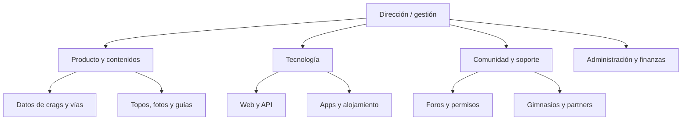
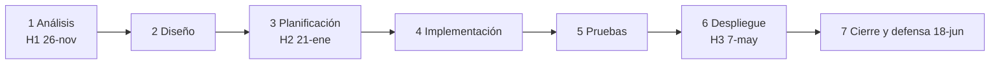

# 01 · Análisis y documentación inicial (RA1) · Myclimbook Web

> Redactado el 24-nov-2026 para la entrega H1 del 26-nov-2026. Fuentes externas
> consultadas el 2026-11-24 salvo indicación contraria. Estado `leído` cuando se abrió
> la página; `sin leer` cuando solo se localizó el enlace o no se pudo acceder
> al documento completo. No se han incluido claves ni datos personales sensibles.

## 1. Sector y empresas (CE 1a, 1b)

**Sector:** servicios digitales para la escalada y la montaña (plataformas de guías de
escalada, bases de datos de vías, aplicaciones de rocódromo y federaciones que gestionan
licencias y senderos). CNAE orientativo: 6312 «Actividades de los portales web» y 9312
«Actividades de los clubes deportivos» para el caso federativo; la clasificación definitiva
se confirmará en H2: en 2026 conviven la CNAE-2009 y la CNAE-2025. Fuente:
[Real Decreto 475/2007, que aprueba la CNAE-2009 y recoge esos códigos](https://www.ine.es/daco/daco42/clasificaciones/cnae09/cnae_2009_rd.pdf)
· 2026-11-24 · `leído` (BOE 102 de 28-04-2007, pp. 18572-18593).

### Empresas y organizaciones del sector

| Organización | Tamaño | Forma jurídica | Ámbito | Producto o servicio | Fuente y fecha de acceso | Estado |
|---|---|---|---|---|---|---|
| theCrag | No publicado en la web abierta | Empresa privada | Mundial | Plataforma colaborativa de crags, rutas, topos, fotos, logbook, foros y solución para gimnasios | [thecrag.com](https://www.thecrag.com/) · 2026-11-24 | `leído` |
| Mountain Project (Adventure Projects / onX) | No publicado; integrada en el grupo onX | Empresa privada | Mundial, con foco en EE. UU. | Guía colaborativa web y app: rutas, fotos, foros, gimnasios y creación de rutas | [mountainproject.com](https://www.mountainproject.com/) · 2026-11-24 | `leído` |
| The Topo (antes 27Crags) | No publicado en la web abierta | Empresa privada | Mundial | Buscador de zonas y vías, creación de topos y apps iOS/Android | [thetopo.com](https://thetopo.com/) · 2026-11-24 | `leído` |
| OpenBeta | Comunidad extendida; tamaño no publicado | Proyecto de código abierto con donaciones | Mundial | Base de datos abierta de escalada, sitio web, API GraphQL y repositorio público | [openbeta.io](https://openbeta.io/) · 2026-11-24 | `leído` |
| Rockfax (UKClimbing Ltd) | Editorial especializada; tamaño no publicado | Sociedad limitada (UKClimbing Ltd) | Reino Unido y Europa | Guías impresas, guía digital por suscripción y artículos de escalada | [rockfax.com](https://www.rockfax.com/) · 2026-11-24 | `leído` |
| FEDME | Federación con federaciones autonómicas y clubes | Entidad sin ánimo de lucro | Estatal | Licencias, organización deportiva, buscador de senderos, formación y seguridad | [fedme.es](https://www.fedme.es/) · 2026-11-24 | `leído` |

**Grupos:**

- **Plataformas colaborativas globales** (theCrag, Mountain Project, The Topo): comunidades
  grandes, contenido generado por usuarios, modelo freemium o gratuito.
- **Datos abiertos y editorial digital** (OpenBeta, Rockfax): OpenBeta comparte API y
  código; Rockfax vende guías digitales de calidad editorial.
- **Sector federativo** (FEDME): organización sin ánimo de lucro, licencias y servicios a
  clubes, con foco en España.

**Empresa tipo:** theCrag, porque reúne las funciones que Myclimbook quiere ofrecer
(catálogo de contenidos, fotos, logbook y solución para gimnasios) y es la referencia más
parecida a una plataforma de escalada con comunidad. Su organigrama exacto no es público;
el de abajo es una deducción razonable a partir de las secciones de su web, no un dato
oficial de la empresa.



**Funciones de cada departamento (deducción a partir de la web pública):**

- **Dirección / gestión:** fija la línea de producto, aprueba alianzas y decide el modelo
  de suscripción; habla con todos los departamentos.
- **Producto y contenidos:** mantiene el catálogo de crags y vías y revisa topos, fotos y
  guías; entrega el contenido a Tecnología y a Comunidad.
- **Tecnología:** desarrolla la web, la API, las apps y el alojamiento; recibe los
  requisitos de Producto y las incidencias de Comunidad.
- **Comunidad y soporte:** gestiona foros, permisos de edición, gimnasios y patrocinadores;
  traslada las quejas de los usuarios a Producto y Tecnología.
- **Administración y finanzas:** gestiona cobros de suscripciones, facturas y obligaciones
  legales; recibe los datos de ventas de Comunidad y Dirección.

## 2. Necesidades y oportunidades (CE 1c, 1d)

**Criterio de priorización:** se ordena primero lo que aparece en más fuentes de la tabla
del SOTA y, a igualdad de menciones, lo que la aplicación Android de Myclimbook ya resolvía
para sus usuarios (documentación de inicio, §§3 y 6).

| Prioridad | Necesidad | Fuente (enlace y fecha) | Por qué en este puesto |
|---|---|---|---|
| 1 | Consultar y compartir vías de escalada con ficha, grado y fotos | [thecrag.com](https://www.thecrag.com/) y [mountainproject.com](https://www.mountainproject.com/) · 2026-11-24 · `leído` | La ofrecen todas las plataformas globales; es el núcleo del servicio |
| 2 | Registrar ascensos y ver el progreso personal | [thecrag.com](https://www.thecrag.com/) (logbook y CPR) y [openbeta.io](https://openbeta.io/) · 2026-11-24 · `leído` | Aparece en varias soluciones y es funcionalidad imprescindible del documento de inicio |
| 3 | Marcar rutas visualmente sobre la foto de un spraywall de rocódromo | [00-documentoInicio.md](00-documentoInicio.md) §§3 y 6 · 2026-11-24 · `leído` (fuente interna) y webs del SOTA, donde no se vio esta función | No aparece en las webs abiertas y es la necesidad específica de Myclimbook |
| 4 | Publicar comentarios y valoraciones sobre muros, sectores y vías | [mountainproject.com](https://www.mountainproject.com/) (foros y fotos) y [thecrag.com](https://www.thecrag.com/) (foros) · 2026-11-24 · `leído` | Mecanismo habitual de calidad colaborativa |
| 5 | Acceder desde móvil y navegador sin instalar una app nativa | [thetopo.com](https://thetopo.com/) y [openbeta.io](https://openbeta.io/) · 2026-11-24 · `leído` | Todas las soluciones comparadas tienen web; la web amplía el alcance de la app Android actual |

**Dato cuantitativo:** según el Consejo Superior de Deportes, en 2025 había **287.536**
licencias de «Montaña y Escalada» (**6,56 %** del total de licencias deportivas) y **2.851**
clubes en esa modalidad. Fuente:
[CSD, *Licencias y clubes deportivos 2025*](https://www.csd.gob.es/sites/default/files/media/files/2026-07/Licencias%20y%20Clubes%202025_0.pdf)
· acceso 2026-11-24 · `leído` (PDF abierto; datos de la tabla de montaña y escalada).

**Oportunidad:** el sector tiene una base amplia y estructurada de licencias y clubes, y
las soluciones revisadas se centran sobre todo en roca y en código abierto. La oportunidad
de Myclimbook no es competir por el mayor catálogo de vías, sino dar a rocódromos y
escaladores una herramienta web visual que ya existe en su app Android y que puede
reutilizar la comunidad y los datos actuales sin una migración costosa.

## 3. Tipo de proyecto elegido (CE 1e)

**Tipo elegido:** evolución web de un producto propio ya existente: aplicación web
responsive con API REST Java/Spring Boot sobre Firebase (Auth, Firestore y Storage), con
editor de marcadores en el cliente.

| Opción | Coste | Tiempo | Encaje con lo que sé |
|---|---|---|---|
| Evolución web sobre Firebase + Spring Boot | Medio (VPS y dominio ya previstos) | Medio | Alto: Java y Firebase ya conocidos; conserva los datos en producción |
| Migración completa a una API REST con MySQL/PostgreSQL | Alto (migración de datos y modelo relacional) | Alto | Medio: más trabajo y riesgo sobre datos reales ya publicados |
| Mantener solo la app Android y publicar las rutas como web estática | Bajo | Bajo | Medio: no permite gestionar muros ni progreso desde el navegador |

Elijo la primera porque conserva la continuidad de Myclimbook y se puede entregar por
funcionalidades antes del 31-mar. Descarto la migración a SQL porque obligaría a trasladar
datos de producción sin una necesidad funcional demostrada, y la web estática porque no
cubre los requisitos RF-02 a RF-05. El editor de marcadores está por decidir entre Canvas
HTML5 y SVG; la decisión se tomará en H2 con una prueba técnica (duda pendiente de tutor).

## 4. Requisitos y restricciones (CE 1f)

### Objetivos

| ID | Objetivo | Cómo se mide | Prioridad |
|---|---|---|---|
| OBJ-01 | Permitir a un escalador gestionar muros con rutas marcadas sobre fotos | Un usuario registrado crea un muro, sube una foto, coloca una ruta y la ve publicada (prueba de aceptación CA-RF-02) | alta |
| OBJ-02 | Permitir documentar sectores de roca con vías y búlders | Un usuario crea un sector con al menos una vía deportiva o un búlder y lo consulta desde la web (CA-RF-03) | alta |
| OBJ-03 | Registrar la actividad y el progreso de la comunidad | Tras marcar una ruta como completada, el perfil muestra el recuento actualizado (CA-RF-05) | media |
| OBJ-04 | Permitir descubrir muros y sectores publicados por otros escaladores | Un visitante consulta el listado público y abre la ficha de un contenido creado por otro usuario | media |

### Tabla de requisitos

| ID | Requisito | Tipo | Cómo se verifica |
|---|---|---|---|
| RF-01 | El visitante puede registrarse e iniciar sesión con correo y contraseña; la recuperación de contraseña envía el enlace del proveedor de identidad | funcional | Prueba P-01: registro, login correcto, login incorrecto y solicitud de recuperación; ver CA-RF-01 |
| RF-02 | El usuario autenticado puede crear un muro, subir una foto y colocar marcadores de ruta sobre la imagen | funcional | Prueba P-02: crear muro, subir imagen y guardar al menos un marcador; ver CA-RF-02 |
| RF-03 | El usuario autenticado puede crear un sector de roca y añadir vías deportivas o problemas de búlder con grado y descripción | funcional | Prueba P-03: alta de sector y de una vía o búlder; ver CA-RF-03 |
| RF-04 | El usuario autenticado puede publicar comentarios y valoraciones en muros, sectores y vías | funcional | Prueba P-04: el comentario y la valoración de 1 a 5 estrellas persisten tras recargar |
| RF-05 | El usuario autenticado puede marcar una ruta como completada y consultar sus estadísticas | funcional | Prueba P-05: tras completar una ruta, el perfil muestra el recuento actualizado; ver CA-RF-05 |
| RNF-01 | La lista de muros carga en menos de 2 s en una conexión de 10 Mbps, medida en 5 repeticiones con las herramientas del navegador | no funcional | Media de 5 mediciones con DevTools; se anota el resultado en el H3 |
| RNF-02 | Las contraseñas se gestionan en Firebase Authentication y nunca se almacenan ni se envían a la API en texto plano | no funcional | Revisión del código y del panel de Firebase; no aparece ningún campo de contraseña en Firestore ni en logs |
| RNF-03 | La interfaz no presenta desbordamiento horizontal en anchos de 360, 390 y 412 px | no funcional | Comprobación en DevTools en esos tres anchos |
| RNF-04 | Las imágenes de muros y sectores se sirven desde Firebase Storage y no se guardan como ficheros locales en el repositorio | no funcional | Revisión del repositorio y de las URLs devueltas por la API |
| REST-01 | El código estará en `main` y con la etiqueta `h1` antes del 26-nov-2026 a las 23:59 | restricción | `git ls-remote --tags origin` y fecha del correo de entrega, según [H1](https://github.com/profeFPInfor/proyectosDAW/blob/main/docs/hitos/H1.md) |
| REST-02 | La primera versión mínima con RF-01 a RF-05 estará operativa antes del 31-mar-2027 | restricción | Comprobación en el despliegue y en el calendario de [fases del proyecto](https://github.com/profeFPInfor/proyectosDAW/blob/main/docs/fases-del-proyecto.md) |
| REST-03 | El backend se implementa con Java 17 y Spring Boot, y la persistencia se mantiene en Firebase Admin SDK | restricción | Revisión del `pom.xml`, del código y de la decisión pendiente de aprobación del tutor |
| REST-04 | No se subirán al repositorio claves de Firebase ni datos personales sensibles de usuarios reales | restricción | Revisión del repositorio con la lista de comprobación del capítulo 04 de la guía |

### Matriz de trazabilidad

| Objetivo | Requisito | Caso de uso | Pantalla o endpoint | Prueba o indicador |
|---|---|---|---|---|
| OBJ-01 | RF-01 | CU-01 Iniciar sesión | `POST /api/auth/login` | P-01 / CA-RF-01 |
| OBJ-01 | RF-02 | CU-02 Crear muro con ruta | `POST /api/walls`, `POST /api/walls/{id}/routes` | P-02 / CA-RF-02 |
| OBJ-01 | RNF-04 | CU-02 Crear muro con ruta | Firebase Storage | Revisión de URLs y repositorio |
| OBJ-02 | RF-03 | CU-03 Crear sector con vía | `POST /api/sectors`, `POST /api/sectors/{id}/routes` | P-03 / CA-RF-03 |
| OBJ-02 | RF-04 | CU-04 Comentar y valorar | `POST /api/comments`, `POST /api/ratings` | P-04 |
| OBJ-03 | RF-05 | CU-05 Completar ruta | `POST /api/progress`, `GET /api/users/me/stats` | P-05 / CA-RF-05 |
| OBJ-01 | RNF-01 | CU-06 Listar muros | `GET /api/walls` | 5 mediciones en DevTools |
| OBJ-01 | RNF-03 | CU-02 Crear muro con ruta | Editor de marcadores | Comprobación en 360/390/412 px |
| OBJ-03 | RNF-02 | CU-01 Iniciar sesión | Firebase Authentication | Revisión de código y Firestore |
| OBJ-01 | REST-03 | CU-02 Crear muro con ruta | API REST Spring Boot | Revisión de `pom.xml` |
| OBJ-03 | REST-04 | CU-05 Completar ruta | Repositorio y Firebase | Revisión de secretos y datos |
| OBJ-01 | REST-01 | CU-00 Entregar H1 | `main` y etiqueta `h1` | `git ls-remote --tags origin` y fecha del correo |
| OBJ-03 | REST-02 | CU-05 Completar ruta | Despliegue del MVP con RF-01 a RF-05 | Comprobación en el despliegue antes del 31-mar-2027 |
| OBJ-04 | RNF-01 | CU-07 Descubrir muros y sectores | `GET /api/walls`, `GET /api/sectors` | P-04 / 5 mediciones en DevTools |

### Criterios de aceptación

```text
CA-RF-01
Dado un visitante sin sesión,
Cuando se registra con un correo nuevo y una contraseña válida,
Entonces Firebase Authentication crea la cuenta y el usuario entra en la web.
Dado un usuario con sesión iniciada,
Cuando solicita recuperar la contraseña,
Entonces recibe el enlace enviado por Firebase y puede restablecerla.

CA-RF-02
Dado un usuario autenticado,
Cuando crea un muro con una foto y guarda un marcador sobre la imagen,
Entonces el muro y su ruta aparecen al recargar la página.
Dado un usuario autenticado con un formulario de muro sin foto,
Cuando intenta publicarlo,
Entonces ve un error indicando que la foto es obligatoria y no se crea el muro.

CA-RF-03
Dado un usuario autenticado,
Cuando crea un sector con una vía deportiva de grado 6a,
Entonces el sector aparece en el listado y la vía muestra su grado.
Dado un usuario autenticado que envía una vía sin grado,
Cuando guarda el formulario,
Entonces ve un error de validación y no se guarda la vía.

CA-RF-05
Dado un usuario con una ruta sin completar,
Cuando pulsa «Completada» en esa ruta,
Entonces el contador de su perfil aumenta en uno una sola vez.
Dado un usuario que ya completó la ruta,
Cuando intenta marcarla de nuevo,
Entonces el contador no cambia y ve el estado «Completada».

CA-RF-04
Dado un usuario autenticado,
Cuando publica un comentario y una valoración de 4 estrellas en un muro,
Entonces ambos aparecen al recargar la ficha del muro.
Dado un usuario autenticado que envía una valoración fuera de 1 a 5,
Cuando intenta publicarla,
Entonces ve un error de validación y no se guarda la valoración.
```

## 5. Obligaciones fiscales, laborales y de prevención (CE 1g)

Aplican a Myclimbook como proyecto personal que presta un servicio digital desde España y,
en su caso, a la comunidad o rocódromo que lo use. No se han encontrado empleados propios
en el momento de redactar este documento; las obligaciones laborales y de PRL se indican
para el supuesto de que exista personal o de que el proyecto se preste desde un rocódromo
con plantilla. Fuentes abiertas el 2026-11-24.

| Ámbito | Obligación y condiciones | Norma (enlace) | Estado |
|---|---|---|---|
| Fiscal | Si el servicio genera ingresos, el IVA grava las prestaciones de servicios efectuadas por empresarios o profesionales (art. 1) | [Ley 37/1992, art. 1](https://www.boe.es/buscar/act.php?id=BOE-A-1992-28740) · 2026-11-24 | `leído` |
| Fiscal | Si se obtiene un rendimiento económico, la renta de la persona física tributa en IRPF; si la actividad la realiza una sociedad, tributa en el Impuesto sobre Sociedades (Ley 27/2014, art. 1) | [Ley 35/2006, arts. 1 y 2](https://www.boe.es/buscar/act.php?id=BOE-A-2006-20764) y [Ley 27/2014, art. 1](https://www.boe.es/buscar/act.php?id=BOE-A-2014-12328) · 2026-11-24 | `leído` (IRPF y art. 1 de la Ley 27/2014) |
| Laboral | Si hay personal, la empresa debe afiliarlo y darlo de alta en la Seguridad Social antes de que comience la actividad | [Ley General de la Seguridad Social, arts. 142 y 156](https://www.boe.es/buscar/act.php?id=BOE-A-2015-11724) y [RD 84/1996, arts. 23 y 24](https://www.boe.es/buscar/act.php?id=BOE-A-1996-4447) · 2026-11-24 | `leído` |
| Laboral | Si hay personal, el contrato se rige por el Estatuto de los Trabajadores y la jornada ordinaria máxima es de 40 horas semanales de promedio anual (art. 34) | [Estatuto de los Trabajadores, arts. 8 y 34](https://www.boe.es/buscar/act.php?id=BOE-A-2015-11430) · 2026-11-24 | `leído` |
| PRL | El empresario debe garantizar la seguridad y salud de los trabajadores y formarlos al contratar o al introducir nuevas tecnologías (Ley 31/1995, arts. 14 a 16; Estatuto, art. 19.4) | [Ley 31/1995](https://www.boe.es/buscar/act.php?id=BOE-A-1995-24292) · 2026-11-24 | `leído` |
| PRL | Si se trabaja con pantallas de visualización de datos, se aplican las disposiciones mínimas de seguridad y salud del RD 488/1997: evaluación de riesgos (art. 3), vigilancia de la salud (art. 4) e información y formación (art. 5) | [Real Decreto 488/1997, arts. 3 a 5](https://www.boe.es/buscar/act.php?id=BOE-A-1997-8671) · 2026-11-24 | `leído` |
| Protección de datos | Myclimbook trata datos de usuarios registrados; se aplica el RGPD y la LOPDGDD (arts. 2, 11 a 15), con base de licitud, política de privacidad y derechos de acceso, rectificación y supresión | [RGPD, Reglamento (UE) 2016/679](https://eur-lex.europa.eu/eli/reg/2016/679/oj) y [Ley Orgánica 3/2018](https://www.boe.es/buscar/act.php?id=BOE-A-2018-16673) · 2026-11-24 | `leído` LOPDGDD (índice y arts. 2 y 4); `sin leer` el texto íntegro del RGPD |

**Lo que no pude comprobar:** el convenio colectivo aplicable a un rocódromo concreto
depende de su actividad y ubicación; no se ha seleccionado ninguno. La situación exacta de
autónomo o sociedad de Myclimbook y el régimen de facturación electrónica vigente se
revisarán con la gestoría y con la nota oficial de la AEAT antes de H2. Se ha leído el
artículo 1 de la Ley 27/2014 y el índice y artículos 2 y 4 de la LOPDGDD; el texto íntegro
del RGPD queda pendiente para H2, por lo que figura como `sin leer`.

## 6. Ayudas y subvenciones (CE 1h)

**Ayuda identificada: Convocatoria CHEQUES 2026 del IDEPA / SEKUENS (Principado de Asturias).**

| Campo | Dato |
|---|---|
| Convocatoria | Resolución de 17 de marzo de 2026 por la que se convoca la concesión de ayudas «Cheques 2026» a PYMES y empresarios individuales para la adquisición de servicios TIC. Código BDNS 833006; extracto en BOPA n.º 58 de 25-III-2026, Cód. 2026-02393 |
| Quién puede pedirla | PYMES y empresarios individuales con actividad en Asturias |
| Qué cubre | Servicios de digitalización prestados por proveedores TIC acreditados: 5.000 € de gasto → 2.500 € de ayuda y 10.000 € → 5.000 € para PYMES; 2.500 € → 1.250 € y 5.000 € → 2.500 € para empresarios individuales |
| Qué excluye | Licencias de software y hardware; solo se financian servicios TIC |
| Importe adicional | El BOPA de 2026-11-13 anuncia una ampliación de 107.500,00 € del crédito de la convocatoria |
| Plazo | Cerrada: la solicitud terminó a las 14:00 del 30-abr-2026 (ampliación de crédito posterior, no de plazo) |
| Cómo se pedía | A través de la sede electrónica del IDEPA/SEKUENS, con la solicitud y la memoria de la actuación |
| Estado | `cerrada` |
| Fuente | [Bases de la convocatoria CHEQUES 2026 (PDF, IDEPA)](https://www.idepa.es/documents/20147/76120/1.9.Convocatoria_Cheques_2026.pdf/f58f9ee0-40c7-89d7-cad5-8c1cb334d8a6) · 2026-11-24 · `leído`; [ampliación de crédito en BOPA, 2026-11-13](https://sede.asturias.es/bopa/2026/11/13/2026-11-13-00019.pdf) · 2026-11-24 · `leído` (anuncio) |

Se descarta Kit Digital como ayuda para esta entrega porque sus convocatorias están
cerradas, tal como advierte la guía H1-C. La ayuda CHEQUES 2026 también está cerrada, pero
sirve para identificar el tipo de financiación aplicable y la línea a vigilar en la
siguiente convocatoria. No se ha solicitado ninguna ayuda: esta ficha solo documenta una
oportunidad real, no una solicitud aprobada.

## 7. Guion de trabajo (CE 1i)

Fases y fechas tomadas de [fases-del-proyecto.md](https://github.com/profeFPInfor/proyectosDAW/blob/main/docs/fases-del-proyecto.md).
La fase 0 (6-nov-2026, creación del repositorio y documento de inicio) ya está cerrada,
así que el guion recoge las **7 fases** restantes del curso. Tablero de seguimiento:
pendiente de crear en GitHub Projects (se añadirá en H2).

| Fase | Fechas | Tareas | Responsable | Hito |
|---|---|---|---|---|
| 1 · Análisis y documentación inicial | 6-nov a 26-nov-2026 | Estudiar sector y SOTA; redactar requisitos, obligaciones, ayudas y guion; revisar el PR | Autor (redacción); tutor (revisión) | **H1 26-nov-2026** |
| 2 · Diseño | 26-nov a 10-dic-2026 | Validar Firebase frente a SQL; decidir Canvas o SVG; arquitectura y modelo de datos; revisar el diseño | Autor (diseño); tutor (revisión) | — |
| 3 · Planificación | 10-dic-2026 a 21-ene-2027 | Cronograma y dependencias; riesgos, protección de datos y presupuesto; revisar la planificación | Autor (planificación); tutor (revisión) | **H2 21-ene-2027** |
| 4 · Implementación | 21-ene a 31-mar-2027 | API REST y autenticación; muros, sectores, comentarios y progreso; validar con usuarios actuales; revisar por PR | Autor (código); tutor (revisión) | — |
| 5 · Pruebas | 1-abr a 23-abr-2027 | Pruebas funcionales y RNF; corregir fallos; verificar requisitos | Autor (pruebas); tutor (verificación) | — |
| 6 · Despliegue | 26-abr a 7-may-2027 | Preparar el VPS con Nginx y HTTPS; publicar la guía de despliegue; revisar el entorno | Autor (despliegue); tutor (revisión) | **H3 7-may-2027** |
| 7 · Seguimiento, control y cierre | 11-feb a 18-jun-2027 | Medir indicadores; registrar incidencias y cambios; redactar la memoria; defender el proyecto; evaluar | Autor (seguimiento y memoria); tutor (evaluación) | — |

Los hitos de entrega son **H1, H2 y H3**. La defensa de los días 20 y 27-may-2027 es la
evaluación final, no un cuarto hito.



## 8. Glosario

| Término | Definición | Sinónimos que NO uso |
|---|---|---|
| Spraywall | Muro de entrenamiento de rocódromo con presas y rutas marcadas, normalmente sobre una fotografía | «muro 3D», «parete» |
| Ruta | Secuencia de presas de un muro o vía de roca identificada por nombre, grado y marcadores | «problema» cuando se habla de rocódromo (en roca sí uso «búlder») |
| Sector | Zona delimitada de escalada en roca que agrupa vías deportivas y problemas de búlder | «zona», «crag» |
| Topo | Representación gráfica de una vía o muro con la posición de los puntos de referencia | «mapa de rutas» (solo para el editor se usa «marcador») |
| Marcador | Punto colocado sobre la foto de un muro para situar una presa o una ruta | «pin», «punto» |
| Búlder | Problema corto de escalada sobre bloque o muro bajo, con grado propio | «bloque» |
| Logbook | Registro personal de ascensos o rutas completadas con fecha y grado | «cuaderno» (se reserva para la alternativa no digital del SOTA) |
| Progreso | Estadística derivada de las rutas marcadas como completadas por un usuario | «ranking» (no se implementa en el MVP) |

---

## Fuentes utilizadas (resumen)

- [01-analisis (plantilla)](https://github.com/profeFPInfor/proyectosDAW/blob/main/plantilla-proyecto/docs/01-analisis.md) y [H1](https://github.com/profeFPInfor/proyectosDAW/blob/main/docs/hitos/H1.md) · 2026-11-24 · `leído`.
- [Documento de inicio](00-documentoInicio.md) y [PROJECT_SUMMARY.md](PROJECT_SUMMARY.md) · 2026-11-24 · `leído`.
- [theCrag](https://www.thecrag.com/) · [Mountain Project](https://www.mountainproject.com/) · [The Topo](https://thetopo.com/) · [OpenBeta](https://openbeta.io/) · [Rockfax](https://www.rockfax.com/) · [FEDME](https://www.fedme.es/) · 2026-11-24 · `leído`.
- [Climbing, *Why Climbers Should Journal*](https://www.climbing.com/skills/why-climbers-should-journal?scope=anon) · 2026-11-24 · `leído` (alternativa no digital del SOTA).
- [CSD, Licencias y clubes 2025](https://www.csd.gob.es/sites/default/files/media/files/2026-07/Licencias%20y%20Clubes%202025_0.pdf) · 2026-11-24 · `leído`.
- Normas en BOE indicadas en el apartado 5 · 2026-11-24 · estado indicado por fila.
- [Convocatoria CHEQUES 2026](https://www.idepa.es/documents/20147/76120/1.9.Convocatoria_Cheques_2026.pdf/f58f9ee0-40c7-89d7-cad5-8c1cb334d8a6) y [BOPA 2026-11-13](https://sede.asturias.es/bopa/2026/11/13/2026-11-13-00019.pdf) · 2026-11-24 · `leído`.
