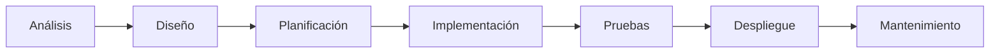

# Metodología de trabajo

[Por definir - se completará siguiendo la metodología del módulo]

## Ciclo de vida del proyecto

## Herramientas

- **Control de versiones**: Git + GitHub
- **Gestión del proyecto**: GitHub Projects (Kanban)
- **Documentación**: Markdown + Mermaid
- **Comunicación**: Aula virtual

## Convenciones de Git

- Commits pequeños y atómicos
- Mensajes en formato convencional:
  - `feat:` nueva funcionalidad
  - `fix:` corrección de errores
  - `docs:` cambios en documentación
  - `style:` formato, punto y coma, etc.
  - `refactor:` reestructuración de código
  - `test:` añadir o modificar pruebas
  - `chore:` tareas de mantenimiento

## Ramas

- `main`: código estable
- `develop`: integración de características
- `feature/[nombre]`: nuevas funcionalidades
- `bugfix/[nombre]`: correcciones
- `hotfix/[nombre]`: parches urgentes
